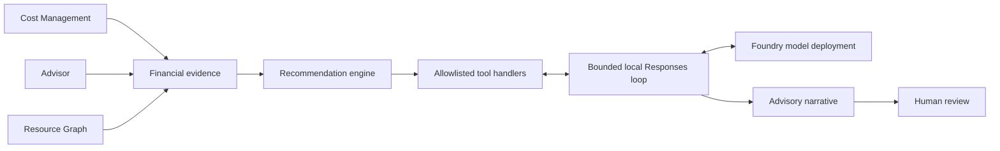

# Azure Cost Intelligence

Experimental advisory-only MVP for Azure cloud economics. Combines actual cost data, Advisor opportunities and Resource Graph observations with a deterministic financial evidence layer and Microsoft Foundry Responses-based explanation. Not production ready. No automatic remediation; an owner must validate any financial estimate and approve any action independently.

## Architecture



The model cannot directly invoke Azure operations. The application exposes seven read-oriented tools, rejects unrecognized or malformed calls, constrains scope, caps requests and tool calls, and fails closed on errors. Actual spend is not savings. Unknown price, period or currency remains unknown; potentially overlapping savings are not summed.

## Reproduce without Azure credentials

Python 3.11:

```sh
python -m unittest discover -s tests -v
python -m pip install -r requirements.txt
python -m pip check
python -m unittest discover -s sdk_tests -v
python -m unittest discover -s foundry_tests -v
python -m src.main --help
```

The first suite uses only the standard library. The two installed-SDK suites replay fabricated HTTP responses, not Azure data. Installation needs PyPI access; tests use fake tokens and transports. See [financial evidence](docs/financial-evidence.md), [management SDK contracts](docs/sdk-contracts.md) and [Foundry orchestration](docs/foundry-orchestration.md). Direct versions are selected; full lock and vulnerability audit remain separate work.

## Optional live configuration (not validated)

Use an existing authorized public-Azure Foundry project and supported model deployment. No provisioning is automated; the former hub setup script is intentionally disabled. Review [Foundry SDK](https://learn.microsoft.com/en-us/python/api/overview/azure/ai-projects-readme) and role requirements with the owner. Use least-privilege read permissions for Cost Management, Advisor and Resource Graph, and authorized inference permissions on the project. Do not grant broad write roles to the runtime identity.

Copy .env.example into an ignored .env file or use an approved secret store. Set the configured subscription, Entra identity, AZURE_AI_PROJECT_ENDPOINT (HTTPS project endpoint, not a connection string), and deployment name. Check data handling before sending any billing/resource metadata to the model. Never commit credentials. Old connection strings and hosted thread IDs are no longer supported.

Only after explicit authorization and budget approval:

```sh
python -m src.main --allow-live "Review the last 30 days of spend"
python -m src.main --allow-live --interactive
python -m examples.run_examples --allow-live
```

Every question is independent, including interactive mode; restate the scope. Live calls may incur charges. The application requests store=false but this does not guarantee zero retention or regulatory compliance. Model output is advisory narrative, not verified financial truth.

## Scope and limitations

- Single configured subscription; resource-group correlation omits subscription-wide idle scans.
- Management and Responses HTTP fixture coverage is not live Azure compatibility, actual billing accuracy, KQL verification or model quality.
- Cost/Graph partial pages fail closed. No price catalog, realized-savings measurement, currency conversion or automated remediation.
- Local bounds limit model requests and tool calls per question, not total runtime or all downstream SDK retries. Not an authenticated multi-tenant boundary.
- No new license or release implied by this maintenance. See [illustrative example](examples/sample_responses.md).
