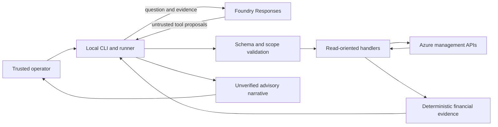

# Architecture review — experimental v0.1.0
Reviewed baseline: 2f34f354ced49f4fb82064bbb50564ca1b867df4 (2026-11-26). Scope: static review of composition, orchestration, tools, management adapters, configuration and CI. Not a penetration test or live deployment review.

## Decision and data flow
A single trusted local operator runs the CLI. The composition root owns one explicit credential and one settings snapshot; ExitStack closes clients in reverse order. The local runner sends the question, instructions and seven tool schemas to Foundry. It validates a completed response and the entire call batch before dispatch; handlers enforce configured subscription scope. Cost Management queries actual spend, Advisor returns provider opportunities, and Resource Graph executes predefined inventory queries. The recommendation engine separates actual cost from uncertain or overlapping savings. Serialized evidence crosses the Foundry boundary for explanation. The terminal displays unverified narrative; a human independently verifies figures and decides actions. No mutation tool or provisioning path is exposed.

## Decisions
- Local orchestration rather than remote agent lifecycle: explicit dispatch, budgets, independent questions and no persistent response IDs. Trade-off: no durable conversation or remote workflow management.
- Single subscription, not a multi-tenant authorization boundary. Resource-group arguments narrow individual queries, not the operator's entitlements or all calls in a question.
- Evidence calculation outside the model. Narrative is not machine-validated against evidence; even a completed model response without tool calls can contain unsupported claims. Do not use it as an authoritative financial report.
- Fail closed on incomplete Cost Management/Graph pages and failed tools rather than silently report partial totals. Advisor iteration and underlying SDK retries are not fully bounded; local output limits apply after retrieval.
- Explicit live opt-in at CLI/examples; Python library construction is trusted code and is not an authorization gate. Use dedicated least-privilege identity, not an administrator.
- Synthetic transport conformance rather than live accuracy claims. See [evaluation](evaluation.md), [SDK contracts](sdk-contracts.md), [financial evidence](financial-evidence.md) and [dependency security](dependency-security.md).

## Residual engineering risks
No end-to-end deadline, spend cap, multi-user isolation, verified output grounding, live RBAC/KQL evidence, data-loss prevention or hash-verified dependency artifacts. Resource Graph has unused helper methods that interpolate input into KQL; these are not exposed to the model and must not be exposed without parameter validation or removal. Cost service methods accept caller-provided subscription IDs directly; the handler is the current model boundary, not a general SDK authorization layer. These are explicit limitations of the trusted-operator prototype, not assurances for deployment as a service. See [threat model](threat-model.md) and [release gate](release-readiness.md).
